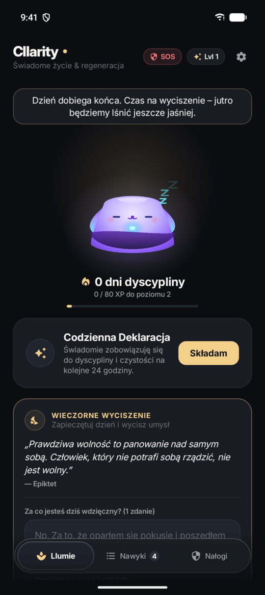
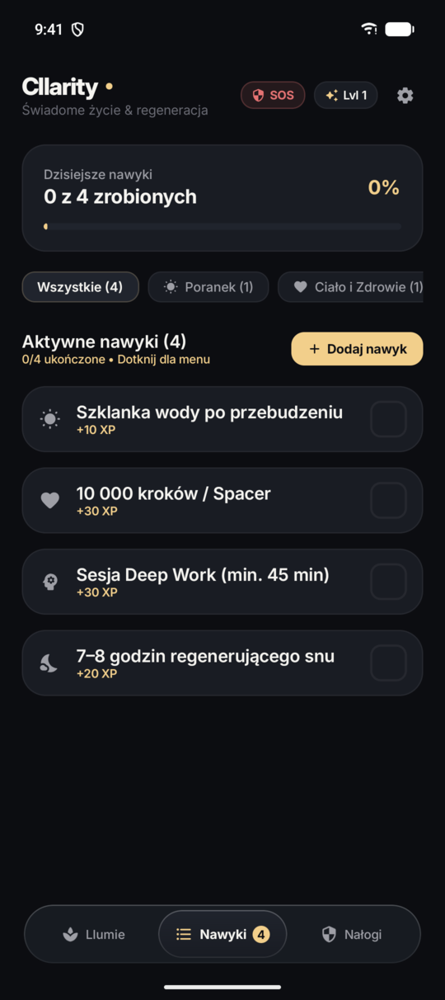
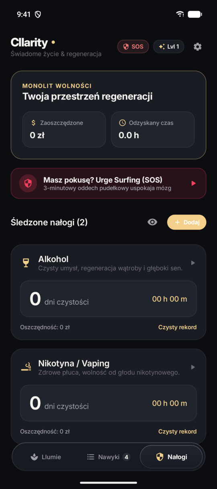
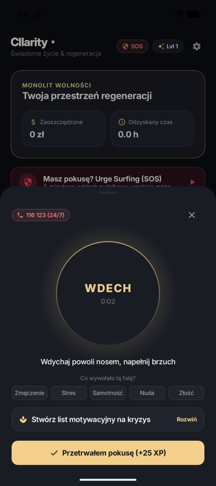
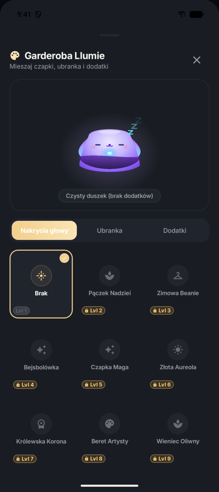

<div align="center">

# Cllarity

**Świadome życie & regeneracja.**
Nawyki, wolność od nałogów i mały świetlisty towarzysz, który rośnie razem z Tobą.


<br/>







</div>

---

## O aplikacji

Cllarity łączy trzy rzeczy, które zwykle żyją w osobnych aplikacjach: **tracker nawyków**, **licznik trzeźwości** i **pomoc w kryzysie**. Spina je **Llumie**, czyli duszek światła, który reaguje na Twoje postępy: cieszy się, gdy dowozisz plan, śpi wieczorem i wspiera Cię po potknięciu, zamiast Cię oceniać.

Interfejs łączy spokój iOS z ekspresją Pixela: ciemne, ciche tło, jeden ciepły akcent „Lumen” i fizyczne, sprężynowe animacje.

## Funkcje

### Llumie – Twój towarzysz
- 5 nastrojów zależnych od Twojego dnia (radosny, dumny, ciepły, senny, wspierający)
- Poziomy i XP za nawyki, deklaracje i przetrwane pokusy
- **Garderoba** z 27 dodatkami (nakrycia głowy, ubranka, akcesoria) odblokowywanymi poziomem lub serią dni oraz 8 kolorami ubranek
- Interaktywność: głaskanie, przechylanie i reakcje haptyczne

### Nawyki
- Gotowe nawyki w 4 kategoriach: Poranek, Ciało i Zdrowie, Skupienie i Umysł, Wieczór i Regeneracja
- Własne nawyki z poziomem trudności, częstotliwością (codziennie / Pn–Pt / weekend) i celem liczbowym („10 000 kroków”)
- Postęp dnia, serie, historia i szczegóły każdego nawyku

### Nałogi
- Licznik czasu wolności z dokładnością do minuty
- **Zaoszczędzone pieniądze** i **odzyskany czas** wyliczane z Twoich danych
- Dziennik wyzwalaczy przy resecie i wykres postępu
- Tryb prywatności, który ukrywa nazwy nałogów na ekranie

### SOS – Urge Surfing
- Prowadzony **oddech pudełkowy 4-4-4-4** z animowanym kręgiem
- Oznaczanie, co wywołało falę (stres, nuda, samotność…)
- **List motywacyjny na kryzys**, który piszesz sobie w spokojniejszej chwili
- Telefony zaufania dostępne jednym dotknięciem

### Rytuały dnia
- Poranna **Codzienna Deklaracja**
- **Wieczorne wyciszenie** z cytatem stoików i pytaniem o wdzięczność

### Prywatność i komfort
- **Blokada biometryczna** aplikacji
- Eksport i import kopii zapasowej (JSON)
- Haptyka i dźwięki z możliwością wyłączenia
- Widżet na ekran główny
- Przewodnik przy pierwszym uruchomieniu

## Design system

Cały wygląd opiera się na tokenach w [`ui/theme`](app/src/main/java/com/cllarity/app/ui/theme). Kod ekranów nie używa surowych wartości.

| Obszar | Plik | Założenia |
|---|---|---|
| Kolor | [`Color.kt`](app/src/main/java/com/cllarity/app/ui/theme/Color.kt) | „Ciche tło, jedno światło”: grafitowe powierzchnie tonalne + jeden akcent `#F2CF8B`. Koral zarezerwowany dla SOS. |
| Typografia | [`Type.kt`](app/src/main/java/com/cllarity/app/ui/theme/Type.kt) | Inter (zmienny): `opsz 14` dla tekstu i `opsz 32` dla nagłówków, tracking wg metryk dynamicznych, cyfry tabelaryczne w licznikach. Minimum 11 sp. |
| Ruch | [`Motion.kt`](app/src/main/java/com/cllarity/app/ui/theme/Motion.kt) | Sprężyny *spatial* (pozycja, skala) i *effects* (alpha, kolor, bez odbicia) oraz gotowe przejścia `fadeThrough`, `sharedAxisX`, `crossfade`. |
| Kształt | [`Shape.kt`](app/src/main/java/com/cllarity/app/ui/theme/Shape.kt) | 6 promieni: Badge 8 · Chip 12 · Tile 16 · Card 22 · Sheet 28 · Pill. |
| Haptyka | [`HapticFeedbackHelper.kt`](app/src/main/java/com/cllarity/app/ui/theme/HapticFeedbackHelper.kt) | Spójny słownik: `tick`, `click`, `success`. |

## Stos technologiczny

- **Kotlin 2.4** + **Jetpack Compose** (BOM 2026.09, Material 3)
- **Android Gradle Plugin 9.4**, Gradle 9.8
- `androidx.biometric` (blokada aplikacji), Gson (zapis stanu i kopie zapasowe)
- Grafika Llumie rysowana proceduralnie na `Canvas`, bez bitmap
- Zapis lokalny w `SharedPreferences`. Aplikacja **nie ma uprawnienia do Internetu**.

## Uruchomienie

**Wymagania:** JDK 17+, Android SDK z platformą **API 37**, urządzenie lub emulator z Androidem 8.0+ (API 26).

```bash
git clone https://github.com/laghert/Cllarity.git
cd Cllarity

# zbuduj i zainstaluj wersję debug na podłączonym urządzeniu
./gradlew installDebug
```

Albo po prostu otwórz projekt w Android Studio i uruchom konfigurację `app`.

Wersja debug instaluje się jako `com.cllarity.app.debug`, więc może działać obok wersji release. W ustawieniach aplikacji znajdziesz **Debug Lab**: skok poziomu, serie, przewijanie czasu nałogów i reset danych.

## Struktura projektu

```
app/src/main/java/com/cllarity/app/
├── MainActivity.kt          # wejście, edge-to-edge, motyw
├── data/                    # CllarityRepository – stan, XP, zapis, kopie zapasowe
├── model/                   # Habit, Addiction, LlumieState (kosmetyki, nastroje)
└── ui/
    ├── screens/             # Home (Llumie), Habits, Addictions
    ├── components/          # arkusze, Llumie, checkbox, wykres, confetti, SOS…
    ├── theme/               # tokeny: kolor, typografia, ruch, kształt, haptyka
    └── widget/              # widżet ekranu głównego
```

## Ważne

Cllarity wspiera budowanie zdrowych nawyków, ale **nie zastępuje profesjonalnej pomocy**. Jeśli jest Ci ciężko, zadzwoń pod **116 123** (telefon zaufania dla dorosłych w kryzysie emocjonalnym), a w sytuacji zagrożenia życia pod **112**.

## Podziękowania

- Krój **[Inter](https://rsms.me/inter/)** autorstwa Rasmusa Anderssona, licencja [SIL Open Font License 1.1](app/src/main/assets/licenses/Inter-OFL.txt)
- Ikony **Material Symbols (Rounded)** od Google, Apache 2.0
